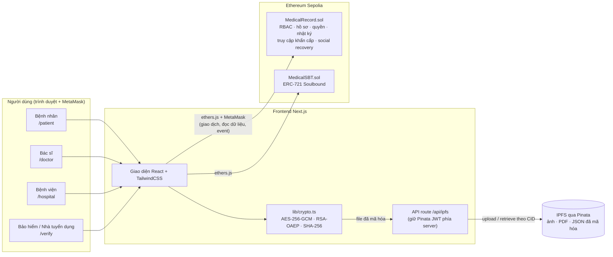
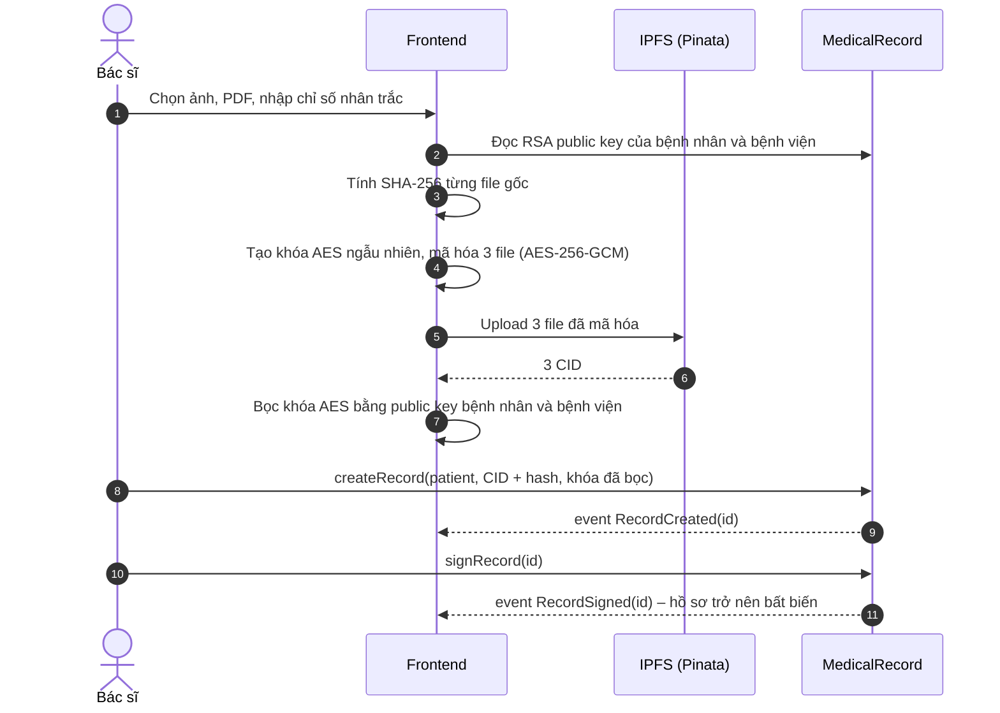
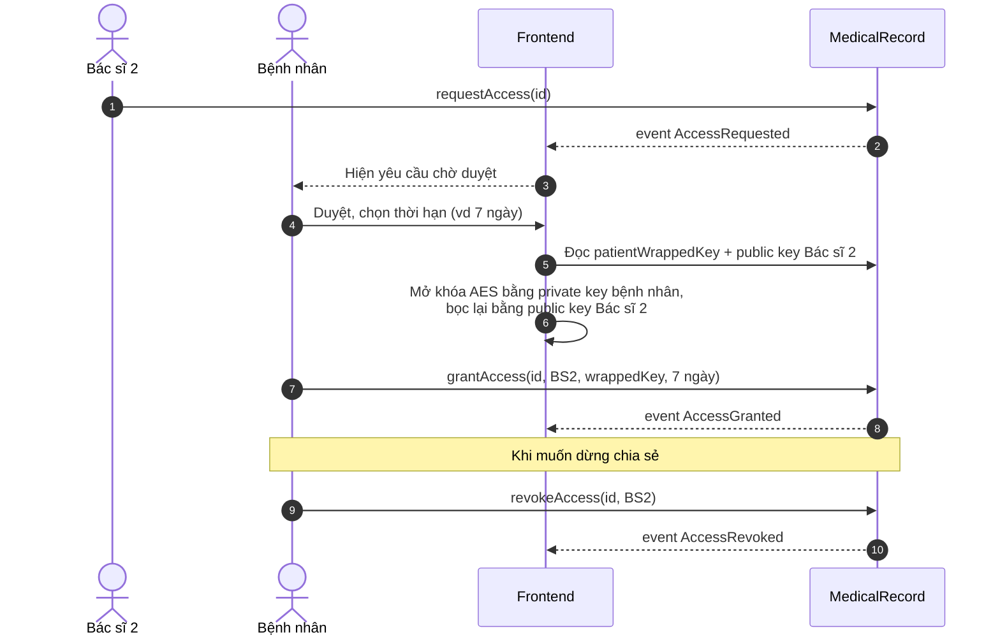
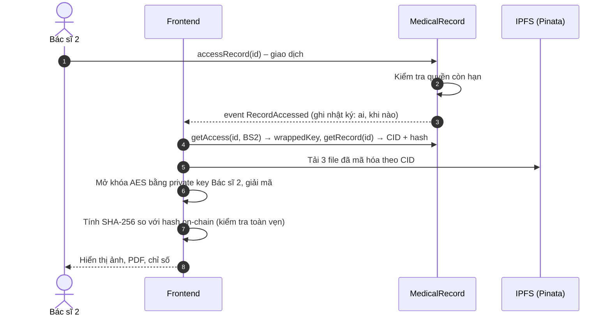
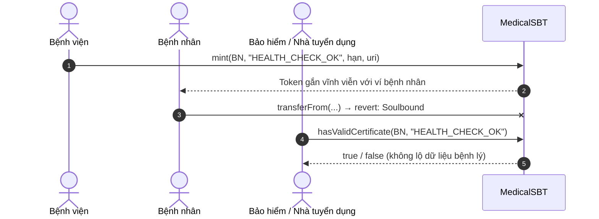
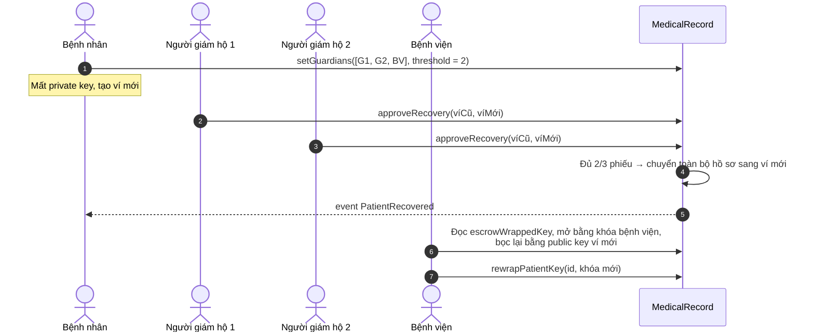
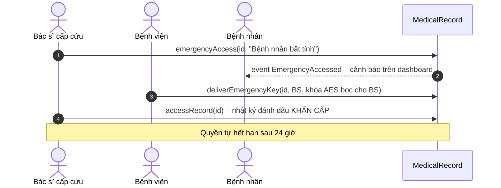

# Thiết kế hệ thống DHR

Tài liệu chốt kiến trúc, phân quyền (RBAC), interface smart contract và các luồng nghiệp vụ.
A và B làm theo đúng interface này để code song song.

## 1. Sơ đồ kiến trúc tổng thể



Nguyên tắc riêng tư: **trên blockchain chỉ có địa chỉ ví, CID, mã băm SHA-256 và khóa AES đã bọc RSA**. Không có tên, địa chỉ, số điện thoại. Mọi file trên IPFS đều đã mã hóa AES-256-GCM.

## 2. Ma trận phân quyền (RBAC)

| Chức năng | Admin | Hospital | Doctor | Patient (chủ hồ sơ) | Verifier |
| --- | :---: | :---: | :---: | :---: | :---: |
| Cấp vai trò Hospital / Verifier | ✅ | | | | |
| Cấp vai trò Doctor | | ✅ | | | |
| Đăng ký RSA public key | ✅ | ✅ | ✅ | ✅ | ✅ |
| Tạo hồ sơ (`createRecord`) | | | ✅ | | |
| Sửa hồ sơ khi chưa ký (`updateRecord`) | | | ✅ (bác sĩ tạo) | | |
| Ký xác nhận (`signRecord`) | | | ✅ (bác sĩ tạo) | | |
| Yêu cầu quyền xem (`requestAccess`) | | | ✅ | | |
| Cấp / thu hồi quyền (`grantAccess` / `revokeAccess`) | | | | ✅ | |
| Xem hồ sơ (`accessRecord`) | | | ✅ (khi còn hạn) | ✅ | |
| Truy cập khẩn cấp (`emergencyAccess`) | | | ✅ | | |
| Giao khóa khẩn cấp (`deliverEmergencyKey`) | | ✅ | | | |
| Chỉ định người giám hộ (`setGuardians`) | | | | ✅ | |
| Phê duyệt khôi phục ví (`approveRecovery`) | | | | Người giám hộ | |
| Mint / thu hồi SBT | | ✅ | | | |
| Xác thực SBT (`hasValidCertificate`) | ✅ | ✅ | ✅ | ✅ | ✅ |

Cài đặt bằng `AccessControl` của OpenZeppelin: `DEFAULT_ADMIN_ROLE`, `HOSPITAL_ROLE`, `DOCTOR_ROLE`, `VERIFIER_ROLE`. Vai trò quản trị của `DOCTOR_ROLE` là `HOSPITAL_ROLE`, nên bệnh viện tự cấp quyền cho bác sĩ. "Bệnh nhân" không phải vai trò mà là **chủ sở hữu từng hồ sơ** (`record.patient`).

## 3. Interface smart contract

### 3.1. `MedicalRecord.sol`

**Dữ liệu chính**

```solidity
struct Record {
    uint256 id;
    address patient;            // chủ sở hữu hồ sơ
    address doctor;             // bác sĩ tạo hồ sơ
    string  imageCid;   bytes32 imageHash;      // ảnh X-quang / siêu âm
    string  pdfCid;     bytes32 pdfHash;        // PDF tóm tắt bệnh án
    string  metadataCid; bytes32 metadataHash;  // JSON nhân trắc học
    string  patientWrappedKey;  // khóa AES bọc bằng RSA public key bệnh nhân
    string  escrowWrappedKey;   // khóa AES bọc bằng RSA public key bệnh viện (dự phòng mất khóa / cấp cứu)
    bool    signed;             // đã ký => bất biến
    uint64  createdAt;
    uint256 previousRecordId;   // 0 nếu là bản đầu tiên
}

struct Access {
    uint64 expiresAt;           // 0 = không có quyền
    bool   emergency;           // true nếu là truy cập khẩn cấp
    string wrappedKey;          // khóa AES bọc bằng RSA public key người được cấp
}
```

**Hàm**

| Hàm | Ai gọi | Ràng buộc chính |
| --- | --- | --- |
| `registerPublicKey(string pem)` | Mọi người | — |
| `createRecord(address patient, FileRefs files, string patientWrappedKey, string escrowWrappedKey, uint256 previousRecordId) → id` | Doctor | `onlyRole(DOCTOR_ROLE)`; bệnh nhân đã đăng ký public key |
| `updateRecord(uint256 id, FileRefs files, string patientWrappedKey, string escrowWrappedKey)` | Doctor tạo hồ sơ | **`notSigned`** |
| `signRecord(uint256 id)` | Doctor tạo hồ sơ | **`notSigned`** |
| `requestAccess(uint256 id)` | Doctor | `onlyRole(DOCTOR_ROLE)` |
| `grantAccess(uint256 id, address grantee, string wrappedKey, uint64 duration)` | Bệnh nhân | **`onlyPatient`**; grantee là Doctor; 1 giờ ≤ duration ≤ 30 ngày |
| `revokeAccess(uint256 id, address grantee)` | Bệnh nhân | **`onlyPatient`** |
| `accessRecord(uint256 id)` (giao dịch, ghi nhật ký) | Bệnh nhân / Doctor | **quyền còn hạn** |
| `emergencyAccess(uint256 id, string reason)` | Doctor | quyền 24 giờ, đánh dấu khẩn cấp |
| `deliverEmergencyKey(uint256 id, address doctor, string wrappedKey)` | Hospital | doctor đang có quyền khẩn cấp còn hạn |
| `setGuardians(address[] guardians, uint8 threshold)` | Bệnh nhân | 1 ≤ threshold ≤ số người giám hộ |
| `approveRecovery(address oldWallet, address newWallet)` | Người giám hộ | đủ `threshold` phiếu thì chuyển toàn bộ hồ sơ sang ví mới |
| `rewrapPatientKey(uint256 id, string newWrappedKey)` | Hospital | dùng sau khôi phục: bọc lại khóa AES cho ví mới từ bản escrow |
| `getRecord(uint256 id) view` | Mọi người | — |
| `getPatientRecords(address patient) view` | Mọi người | — |
| `getAccess(uint256 id, address user) view` | Mọi người | — |
| `verifyFile(uint256 id, uint8 kind, bytes32 hash) view → bool` | Mọi người | kind: 0 ảnh, 1 PDF, 2 JSON |

`FileRefs` = `{ imageCid, imageHash, pdfCid, pdfHash, metadataCid, metadataHash }`.

**Event**: `PublicKeyRegistered`, `RecordCreated`, `RecordUpdated`, `RecordSigned`, `AccessRequested`, `AccessGranted`, `AccessRevoked`, `RecordAccessed(id, accessor, timestamp, emergency)`, `EmergencyAccessed(id, doctor, reason, expiresAt)`, `EmergencyKeyDelivered`, `GuardiansSet`, `RecoveryApproved`, `PatientRecovered`.

### 3.2. `MedicalSBT.sol`

| Hàm | Ai gọi | Ghi chú |
| --- | --- | --- |
| `mint(address patient, string certType, uint64 expiresAt, string uri) → tokenId` | Hospital | Ví dụ certType: `HEALTH_CHECK_OK`, `VACCINATION_HEPB` |
| `revoke(uint256 tokenId)` | Hospital | Đốt token |
| `hasValidCertificate(address patient, string certType) view → bool` | Mọi người | Chỉ trả về đúng/sai, không lộ bệnh lý |
| `locked(uint256 tokenId) view → bool` | Mọi người | Luôn `true` (chuẩn ERC-5192) |
| `transferFrom`, `safeTransferFrom`, `approve`, `setApprovalForAll` | — | **Luôn revert** (Soulbound) |

### 3.3. Các ràng buộc logic

1. **`onlyPatient`**: chỉ chủ hồ sơ mới cấp hoặc thu hồi quyền.
2. **`notSigned`**: hồ sơ đã được bác sĩ ký thì không sửa được nữa; muốn đính chính phải tạo bản mới trỏ về `previousRecordId`.
3. **Quyền có thời hạn**: `accessRecord` kiểm tra `block.timestamp < expiresAt`.
4. **Kiểm tra vai trò**: `onlyRole(...)` trên các hàm nhạy cảm.
5. **Soulbound**: mọi thao tác chuyển nhượng SBT đều revert.

## 4. Sơ đồ tuần tự

### 4.1. Tạo hồ sơ



### 4.2. Yêu cầu, cấp và thu hồi quyền



### 4.3. Bác sĩ xem hồ sơ (retrieve)



### 4.4. Cấp và xác thực chứng nhận SBT



### 4.5. Khôi phục khi bệnh nhân mất private key



### 4.6. Truy cập khẩn cấp (mở rộng)


